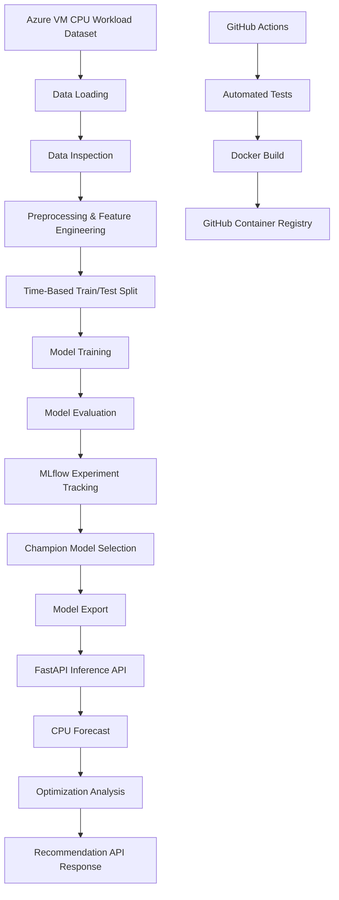
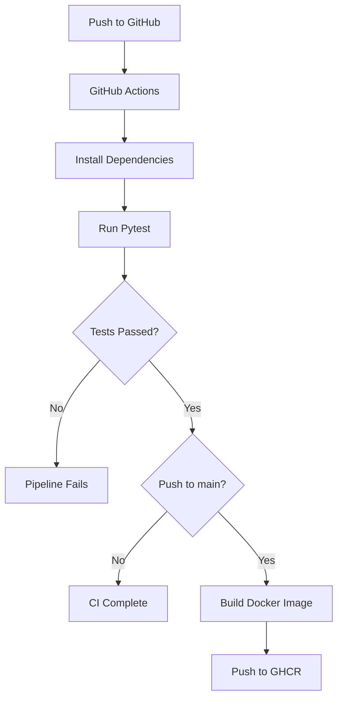

# CloudCost AI — CPU Forecasting & Cloud Optimization

A machine learning-powered cloud resource monitoring and optimization system that forecasts virtual machine CPU utilization and identifies potential resource optimization opportunities.

CloudCost AI uses historical CPU usage patterns to predict future utilization, helping identify underutilized and highly utilized virtual machines. It combines machine learning, experiment tracking, API development, containerization, and automated CI/CD into a single end-to-end project.

---

## Overview

Cloud infrastructure resources are often over-provisioned, resulting in unnecessary infrastructure costs. At the same time, under-provisioned resources can experience high utilization and performance issues.

CloudCost AI aims to address this problem by:

- Forecasting future CPU utilization using historical workload data.
- Identifying underutilized and high-utilization virtual machines.
- Providing actionable optimization recommendations.
- Exposing predictions through a REST API.
- Tracking machine learning experiments and models using MLflow.
- Containerizing the application using Docker.
- Automating testing and container publishing through GitHub Actions.

---

## Project Objectives

- Build an end-to-end machine learning pipeline.
- Perform time-series feature engineering on CPU workload data.
- Train and compare multiple regression models.
- Evaluate models using appropriate regression metrics.
- Track experiments and manage models using MLflow.
- Serve predictions using FastAPI.
- Develop a rule-based CPU optimization recommendation system.
- Dockerize the application.
- Implement automated testing and CI/CD using GitHub Actions.
- Publish Docker images to GitHub Container Registry (GHCR).

---

## System Architecture



---

## Machine Learning Pipeline

### Step 1 — Data Collection

The project uses CPU utilization traces from an Azure cloud workload dataset.

The dataset contains historical CPU utilization readings from virtual machines over time. These readings are used to understand workload patterns and train a forecasting model.

For the initial experimentation, a deterministic subset of 100 virtual machines was selected to make the data processing and experimentation manageable.

**Dataset characteristics:**

| Property | Value |
|---|---|
| Data source | Azure workload CPU traces |
| Selected virtual machines | 100 |
| Raw records in selected dataset | 13,400 |
| Readings per VM | 134 |
| Sampling interval | 5 minutes |
| Target variable | Average CPU utilization |

The selected workload subset is saved for subsequent processing and experimentation.

---

### Step 2 — Data Inspection

Before training, the dataset is inspected to understand:

- Dataset structure and column types.
- CPU utilization distribution.
- Missing or invalid values.
- VM-level workload patterns.
- Data consistency and timestamps.

This step helps ensure the dataset is suitable for preprocessing and model training.

---

### Step 3 — Preprocessing & Feature Engineering

Instead of predicting CPU utilization using only the current observation, CloudCost AI uses historical CPU readings to construct time-series features.

The target variable is:

`avg_cpu`

The following features are generated:

| Feature | Description |
|---|---|
| `lag_1` | CPU utilization from the previous time step |
| `lag_2` | CPU utilization from two time steps earlier |
| `lag_3` | CPU utilization from three time steps earlier |
| `lag_6` | CPU utilization from six time steps earlier |
| `lag_12` | CPU utilization from twelve time steps earlier |
| `rolling_mean_3` | Average CPU utilization over the previous 3 readings |
| `rolling_mean_6` | Average CPU utilization over the previous 6 readings |
| `rolling_std_6` | Standard deviation of CPU utilization over the previous 6 readings |
| `rolling_max_6` | Maximum CPU utilization over the previous 6 readings |

All rolling features are shifted to ensure that the target observation is not included in its own input features.

This prevents data leakage and ensures that the model only uses historical information to predict future CPU utilization.

Since the data is grouped by virtual machine, the historical features are generated independently for each VM.

---

### Step 4 — Train/Test Split

The dataset is divided into training and testing data using a time-based split.

Earlier observations are used to train the model, while later observations are used to evaluate it.

A random split is avoided because this is a time-series forecasting problem. Randomly distributing observations could allow future data to appear in the training set while earlier data appears in the testing set.

A temporal split better represents how the model would behave when predicting future CPU utilization using past observations.

---

### Step 5 — Model Training

Three regression models were trained and compared:

1. Linear Regression
2. Random Forest Regressor
3. Gradient Boosting Regressor

#### Linear Regression

Used as a baseline model to understand the relationship between historical CPU features and future CPU utilization.

#### Random Forest Regressor

Uses multiple decision trees to capture nonlinear relationships between historical CPU patterns and future workload behavior.

#### Gradient Boosting Regressor

Builds sequential trees that attempt to improve upon the errors made by previous trees.

The models were trained using the same engineered features and evaluated on the same temporal test set.

---

### Step 6 — Model Evaluation

The models were evaluated using three regression metrics.

| Metric | Purpose |
|---|---|
| MAE | Measures the average absolute difference between predicted and actual CPU utilization |
| RMSE | Penalizes larger prediction errors more heavily |
| R² Score | Measures how well the model explains the variance in the target variable |

#### Model Comparison

| Model | MAE | RMSE | R² |
|---|---:|---:|---:|
| Linear Regression | 1.7699 | 4.0701 | 0.9322 |
| Random Forest | **1.2731** | **3.5212** | **0.9493** |
| Gradient Boosting | 1.3871 | 3.5470 | 0.9485 |

Random Forest achieved the best overall performance on the evaluated test set, with the lowest MAE and RMSE and the highest R² score among the three models.

Therefore, Random Forest was selected as the champion model.

---

### Step 7 — Experiment Tracking with MLflow

MLflow was used to track machine learning experiments and manage the trained model.

It provides a centralized record of model experiments, evaluation results, and registered models.

The project uses MLflow for:

- Experiment tracking.
- Logging model evaluation metrics.
- Comparing trained models.
- Recording model artifacts.
- Model registration.
- Champion model management through aliases.

The trained model is registered as:

`CloudCostAI_CPU_Forecaster`

The selected model version is assigned the alias:

`champion`

This provides a clear reference to the model selected for inference rather than hardcoding a particular model version throughout the application.

#### MLflow Dashboard

The MLflow dashboard allows experiments and model performance to be inspected visually.


---

### Step 8 — Champion Model Export

Once the champion model is selected, it is exported as a standalone model artifact:

`models/champion.joblib`

This allows the inference application to load the model directly without depending on the MLflow tracking server during API execution.

MLflow is used during experimentation and model selection, while the exported model artifact is used for inference.

This separation makes the application easier to package and deploy.

---

## CPU Forecasting & Optimization Logic

### Step 9 — CPU Prediction

The API receives historical CPU utilization readings for a virtual machine.

The inference pipeline:

1. Validates the CPU history.
2. Extracts the required historical features.
3. Constructs the feature DataFrame in the same order used during training.
4. Loads the champion model artifact.
5. Generates a CPU utilization prediction.
6. Clips the predicted value to the valid CPU utilization range of 0–100%.

The API returns the predicted CPU utilization for the requested VM.

---

### Step 10 — Optimization Analysis

After forecasting CPU utilization, CloudCost AI evaluates the predicted CPU value using a rule-based recommendation engine.

| Predicted CPU | Status | Recommendation |
|---|---|---|
| Below 20% | UNDERUTILIZED | Investigate over-provisioning and consider reducing allocated resources |
| 20% to below 70% | HEALTHY | Resource utilization is within the healthy range |
| 70% to 85% | HIGH | Monitor workload and consider capacity planning |
| Above 85% | CRITICAL | Investigate potential resource bottlenecks and consider scaling resources |

These thresholds are configurable project-level decision rules, not universal cloud-provider standards.

The recommendation engine combines machine learning forecasting with predefined operational rules to convert predictions into actionable insights.

---

## REST API — FastAPI

CloudCost AI exposes its prediction and optimization functionality through a REST API built using FastAPI.

The API allows external applications or monitoring systems to submit CPU history and receive predictions or optimization recommendations.

### Available Endpoints

| Method | Endpoint | Description |
|---|---|---|
| GET | `/` | Returns API information |
| GET | `/health` | Health endpoint |
| POST | `/predict` | Predicts CPU utilization |
| POST | `/optimize` | Predicts CPU utilization and generates an optimization recommendation |

---

### 1. Root Endpoint

**Endpoint:**

`GET /`

Returns basic API information.

---

### 2. Health Endpoint

**Endpoint:**

`GET /health`

Used to check whether the API is responding.


---

### 3. CPU Prediction Endpoint

**Endpoint:**

`POST /predict`

Accepts a VM identifier and its historical CPU readings.

#### Request

```json
{
  "vm_id": "vm-001",
  "cpu_history": [
    12.5, 14.2, 16.1, 15.8,
    18.3, 20.1, 19.7, 21.5,
    23.1, 22.4, 24.8, 26.2
  ]
}
```

The API uses the supplied CPU history to construct model features and generate the predicted CPU utilization.


---

### 4. Optimization Endpoint

**Endpoint:**

`POST /optimize`

This endpoint combines the forecasting model and optimization logic.

It:

1. Accepts historical CPU utilization.
2. Predicts future CPU utilization.
3. Evaluates the predicted value against the optimization thresholds.
4. Returns the predicted utilization, status, and recommendation.

#### Request

```json
{
  "vm_id": "vm-001",
  "cpu_history": [
    12.5, 14.2, 16.1, 15.8,
    18.3, 20.1, 19.7, 21.5,
    23.1, 22.4, 24.8, 26.2
  ]
}
```


---

### API Validation

The API includes input validation to prevent invalid requests from reaching the prediction pipeline.

Validation includes:

- Minimum historical CPU readings required for feature generation.
- CPU utilization values must be between 0 and 100.
- Invalid requests are rejected with HTTP 422 validation errors.

#### Invalid Input Test


---

### High CPU Utilization Scenario

A high CPU utilization prediction is evaluated by the recommendation engine and can result in a `HIGH` or `CRITICAL` status depending on the predicted utilization.


---

## Project Structure

```text
CloudCost-AI/
│
├── .github/
│   └── workflows/
│       └── ci.yml
│
├── data/
│   ├── raw/
│   └── processed/
│
├── image/
│   ├── health.png
│   ├── highcpu.png
│   ├── invalid.png
│   ├── mlflow.png
│   ├── optimize.png
│   └── predict.png
│
├── models/
│   └── champion.joblib
│
├── src/
│   ├── __init__.py
│   ├── api.py
│   ├── data_loader.py
│   ├── inspect_data.py
│   ├── inference.py
│   ├── optimization.py
│   └── preprocessing.py
│
├── tests/
│
├── Dockerfile
├── .dockerignore
├── .gitignore
├── main.py
├── train.py
├── export_model.py
├── requirements.txt
└── README.md
```

---

## Tech Stack

| Technology | Purpose |
|---|---|
| Python 3.11 | Primary programming language |
| Pandas | Data manipulation and feature engineering |
| NumPy | Numerical computations |
| Scikit-learn | Model training and evaluation |
| Matplotlib / Seaborn | Data visualization |
| MLflow | Experiment tracking and model registry |
| Joblib | Model serialization |
| FastAPI | REST API development |
| Pydantic | Request validation |
| Pytest | Automated testing |
| HTTPX | API testing |
| Docker | Application containerization |
| GitHub Actions | CI/CD automation |
| GitHub Container Registry | Docker image storage |

---

## Running the Project Locally

### Step 1 — Clone the Repository

```bash
git clone https://github.com/YOUR_USERNAME/CloudCost-AI.git
cd CloudCost-AI
```

### Step 2 — Create a Virtual Environment

```bash
python -m venv venv
```

Activate it on Windows:

```bash
venv\Scripts\activate
```

Activate it on Linux/macOS:

```bash
source venv/bin/activate
```

### Step 3 — Install Dependencies

```bash
pip install -r requirements.txt
```

### Step 4 — Run the API

```bash
uvicorn src.api:app --reload
```

The API will be available at:

`http://127.0.0.1:8000`

### Step 5 — Explore API Documentation

FastAPI automatically generates interactive API documentation.

Swagger UI:

`http://127.0.0.1:8000/docs`

Alternative documentation:

`http://127.0.0.1:8000/redoc`

You can directly execute API requests through Swagger UI.

---

## Running MLflow

To view MLflow experiments, run:

```bash
mlflow ui
```

Open:

`http://127.0.0.1:5000`

The dashboard allows you to compare model metrics, review experiments, and inspect registered models.

---

## Docker

CloudCost AI is containerized using Docker to provide a consistent runtime environment.

### Build the Docker Image

```bash
docker build -t cloudcost-ai .
```

### Run the Container

```bash
docker run -p 8000:8000 cloudcost-ai
```

The API will be accessible at:

`http://localhost:8000`

Swagger documentation:

`http://localhost:8000/docs`

Docker packages the API, its dependencies, and the exported champion model into a portable container image.

---

## Automated Testing

The project uses Pytest and FastAPI TestClient to test API functionality.

Tests cover:

- Root endpoint.
- Health endpoint.
- CPU prediction endpoint.
- Optimization recommendations.
- Underutilized CPU scenario.
- High CPU scenario.
- Invalid CPU history.
- CPU values outside the valid range.

Run the tests using:

```bash
python -m pytest tests/ -v
```

Automated tests help detect regressions before the application is packaged and published.

---

## CI/CD Pipeline — GitHub Actions

GitHub Actions automates the testing and container publishing workflow.

The pipeline is triggered by:

- Pushes to `main`.
- Pull requests targeting `main`.
- Manual workflow execution.

### CI — Continuous Integration

The test job:

1. Checks out the repository.
2. Sets up Python 3.11.
3. Installs project dependencies.
4. Executes the automated test suite.

If tests fail, the subsequent build-and-publish job is not executed.

### CD — Build & Publish

After the test job succeeds, pushes to `main` trigger the publishing job.

The publishing job:

1. Checks out the repository.
2. Sets up Docker Buildx.
3. Authenticates with GitHub Container Registry.
4. Generates Docker image tags.
5. Builds the Docker image.
6. Pushes the image to GHCR.

The workflow publishes images with:

- `latest` — latest published version.
- Commit SHA tag — identifies a specific source-code revision.

### Pipeline Flow



This pipeline ensures that the application is tested before its container image is published.

---


## Key Engineering Decisions

### 1. Time-Based Data Splitting

A temporal split was used instead of a random split to better represent future CPU forecasting and reduce the risk of temporal data leakage.

### 2. Historical Feature Engineering

Lag and rolling-window features allow the models to capture recent workload patterns rather than relying on a single CPU observation.

### 3. Model Comparison

Multiple regression models were evaluated rather than relying on one algorithm without comparison. The champion was selected based on test-set performance.

### 4. MLflow for Experiment Tracking

MLflow separates experimentation, metric comparison, and model registration from the inference application.

### 5. Standalone Model Artifact

The champion model is exported as a Joblib artifact so the inference API can load it without requiring the MLflow tracking environment at runtime.

### 6. FastAPI

FastAPI provides lightweight REST endpoints, request validation, and automatically generated API documentation.

### 7. Docker

Containerization ensures that the API and its runtime dependencies can be packaged and executed consistently across environments.

### 8. CI/CD

GitHub Actions automates testing and container publishing, reducing the need for manually validating and building every release.

## Author

**Komal Singh**
**Pranjal Singh**

